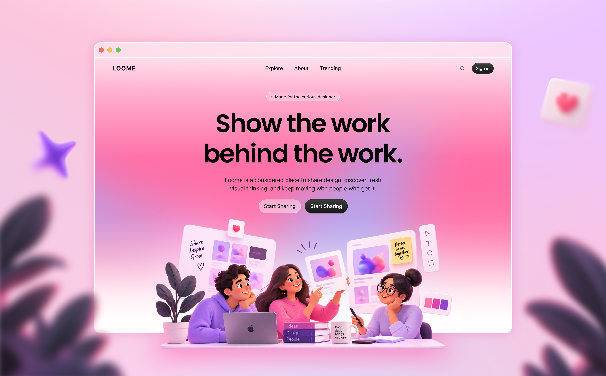

# Loome Client

Loome is a design-sharing platform for publishing work, discovering visual ideas, and connecting with other designers. This repository contains the responsive Next.js frontend and the client-side authentication and platform routes.



## Project links

- Live site: Not publicly deployed yet
- Client repository: [github.com/RizviBR0/loome-client](https://github.com/RizviBR0/loome-client)
- Server repository: [github.com/RizviBR0/loome-server](https://github.com/RizviBR0/loome-server)
- Local client: [http://localhost:3000](http://localhost:3000)
- Local API: [http://localhost:8000](http://localhost:8000)

## Core features

- Editorial landing page with hero, featured work, categories, testimonials, FAQ, and creator CTA sections.
- Searchable, filterable, and sortable Explore archive.
- Public design detail pages with galleries, view counts, likes, comments, and reporting.
- Better Auth email/password authentication with protected creator and admin areas.
- Creator upload flow and Studio dashboard for managing published designs.
- Admin dashboard with platform statistics, user management, reports, and design moderation.
- Responsive visual system built for mobile, tablet, and desktop screens.

## Technologies and dependencies

- [Next.js](https://nextjs.org/) 16 with the App Router
- [React](https://react.dev/) 19 and [TypeScript](https://www.typescriptlang.org/)
- [Tailwind CSS](https://tailwindcss.com/) 4
- [MongoDB](https://www.mongodb.com/) with the `mongodb` driver and Better Auth Mongo adapter
- [Better Auth](https://www.better-auth.com/) for authentication
- [Lucide React](https://lucide.dev/) for icons
- [Recharts](https://recharts.org/) for admin analytics
- [React Hot Toast](https://react-hot-toast.com/) for notifications
- ESLint and `eslint-config-next` for code quality

## Run locally

### Prerequisites

- Node.js 20.9 or newer
- npm
- A MongoDB database, local or MongoDB Atlas
- The Loome server running locally, unless `NEXT_PUBLIC_SERVER_URL` points to a deployed API

### Setup

```bash
git clone https://github.com/RizviBR0/loome-client.git
cd loome-client
npm install
```

Create `.env.local` from the example file:

```bash
cp .env.example .env.local
```

On Windows PowerShell, use `Copy-Item .env.example .env.local` instead. Set the values for your MongoDB instance and keep the local service URLs aligned with the server:

```env
MONGODB_URI=mongodb+srv://<username>:<password>@<cluster>/<database>
MONGODB_DB=loome
BETTER_AUTH_SECRET=<long-random-secret>
BETTER_AUTH_URL=http://localhost:3000
NEXT_PUBLIC_SERVER_URL=http://localhost:8000
ADMIN_EMAILS=admin@loome.design
NEXT_PUBLIC_ADMIN_EMAILS=admin@loome.design
```

Start the API in a separate terminal using the [server README](https://github.com/RizviBR0/loome-server#run-locally), then start the client:

```bash
npm run dev
```

Open [http://localhost:3000](http://localhost:3000).

## Available scripts

```bash
npm run dev      # Start the development server
npm run lint     # Run ESLint
npm run build    # Create a production build
npm run start    # Serve the production build
```

## Demo accounts

The login screen can auto-fill the assignment demo accounts:

- Designer: `demo@loome.design` / `loome-demo-2026`
- Admin: `admin@loome.design` / `loome-admin-2026`

Persistent accounts and content require a reachable MongoDB connection and matching client/server environment variables.
